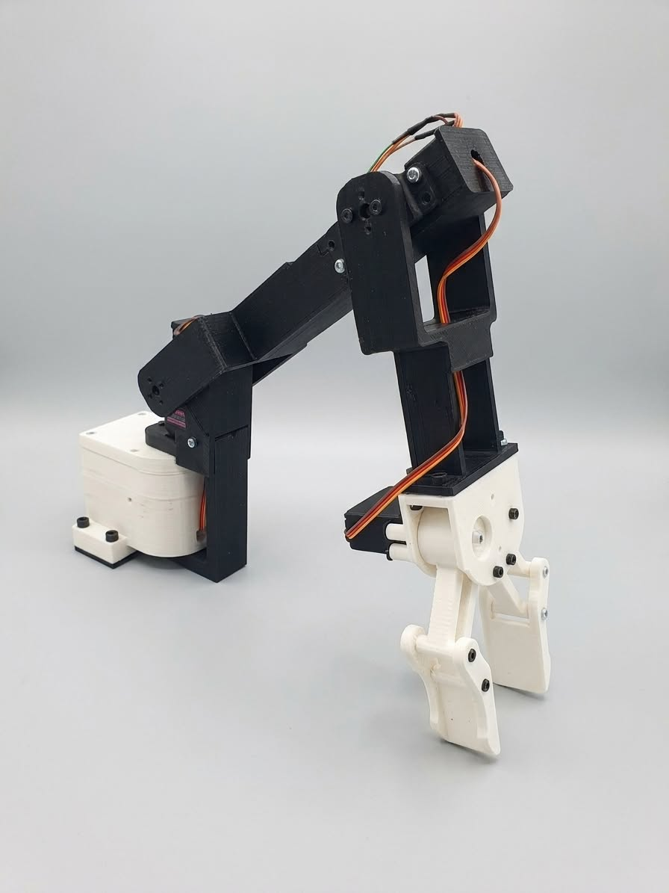

# 🤖 Nanobot: Open-Source Educational Mobile Manipulator

**Nanobot** is an affordable, modular, open-source mobile manipulator powered by **ROS2** and an **ESP32 math engine**. Designed for engineering students, educators, and robotics developers, Nanobot bridges the gap between theoretical control theory (kinematics, joint angles, base velocities) and physical hardware implementation.

---

## 📸 Overview & Hardware Architecture

<p align="center">
  
</p>

Nanobot unifies modern robotic stacks—allowing a host PC running ROS2 to communicate wirelessly via Wi-Fi with an ESP32 microcontroller to execute closed-loop base navigation and precise joint-angle arm control.

<p align="center">
  
</p>

---

## 🚀 Key Features

* **ROS2 Integration:** Full native support for ROS2 nodes, TF2 transformations, and MoveIt2 path planning.
* **ESP32 Microcontroller Core:** Low-cost, highly accessible computing and communication layer for real-time motor and servo control.
* **3D Printable Mechanical Design:** Accessible chassis and multi-DOF arm structure optimized for rapid prototyping and local fabrication (laser-cut/3D printed).
* **Affordable Pricing Tiers:** Structured from standalone mechanical kits up to complete DIY electronics and fully assembled custom units.

---

## 🎥 Video Demonstrations

Watch Nanobot in action:

* **[Nanobot Overview & Demonstration 1](https://youtu.be/QfQ76SFpOAc)**
* **[Nanobot ROS2 Control & Navigation 2](https://youtu.be/g3tPRG9t1u4)**

---

## 🛠️ System Specifications

| Component | Technology / Spec |
| :--- | :--- |
| **Control Engine** | ESP32 Microcontroller (Wi-Fi / Serial Bridge) |
| **Software Framework** | ROS2 (Humble / Iron / Jazzy compatible) |
| **Perception & Planning** | OpenCV, YOLOv8 monocular pipelines, MoveIt2 |
| **Fabrication** | 3D Printed ABS/PLA & Acrylic Laser-Cut Chassis |

---

## 📦 Repository Structure

```text
├── cad/                  # 3D printable files & laser-cutting DXFs
├── firmware/             # ESP32 Micro-XRCE-DDS / Arduino firmware
├── ros2_ws/              # ROS2 packages (bringup, description, moveit config)
└── docs/                 # Wiring diagrams, schematics, and user guides
